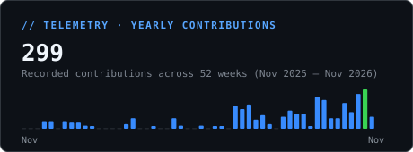
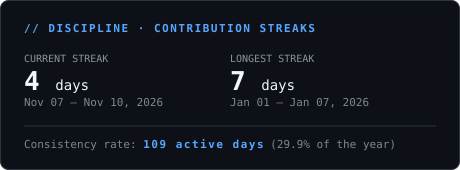
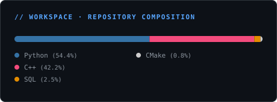
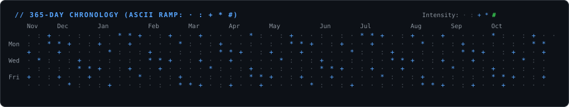

<picture>
  <source media="(prefers-color-scheme: dark)" srcset="dark_mode.svg" />
  <source media="(prefers-color-scheme: light)" srcset="light_mode.svg" />
  
</picture>

# Hi there, I'm Raj Patil

  
  &nbsp;
  
  &nbsp;
  
  &nbsp;
  
  &nbsp;
  

> CSE Undergrad at **VNIT Nagpur** building high-throughput low-latency systems, lock-free concurrent structures in modern C++20, and resilient distributed architectures. Open-source contributor to **[QuantLib](https://github.com/lballabio/QuantLib)**. Zero third-party analytics — telemetry rendered natively by this repo.

 

- **CSE Undergrad** at **VNIT Nagpur**
- **Core Interests:** Low-latency systems, lock-free concurrency, high-performance C++20, and distributed architectures.
- **Quant & Systems Research:** Order matching, SPSC lock-free queues, memory models, cache-line alignment, and cross-currency arbitrage engines.
- **Open Source:** Contributor to **[QuantLib](https://github.com/lballabio/QuantLib)** — the premier quantitative finance C++ library (yield curve exponential spline fitting & interest rate coupons).
- Passionate about deep algorithmic problem solving and writing clean, cache-friendly, production-grade code.

 

  <picture>
    <source media="(prefers-color-scheme: dark)" srcset="stack.svg">
    <source media="(prefers-color-scheme: light)" srcset="stack_light.svg">
    
  </picture>

 

| Project | Focus Area | Description |
| :--- | :--- | :--- |
| **[QuantLib](https://github.com/lballabio/QuantLib)** | <samp>Open Source · Quant C++</samp> | Contributor to the premier quantitative finance C++ library: interest rate coupons ([#3036](https://github.com/lballabio/QuantLib/pull/3036)) & exponential spline fitting algorithms ([#3056](https://github.com/lballabio/QuantLib/pull/3056)). |
| **[FX-Arbitrage-Detector](https://github.com/RAJ-A58/FX-Arbitrage-Detector)** | <samp>High-Performance Systems</samp> | C++17 engine using negative-log Bellman-Ford to detect FX currency arbitrage loops accounting for real-world bid/ask spreads & fees. |
| **[cpp-concurrency-journey](https://github.com/RAJ-A58/cpp-concurrency-journey)** | <samp>Quant / Low-Latency</samp> | Low-latency C++20 concurrency exploration: lock-free SPSC ring buffers, cache-line alignment, atomic memory models for HFT applications. |
| **[Blinkit-concurrency-poc](https://github.com/RAJ-A58/Blinkit-concurrency-poc)** | <samp>Distributed Systems</samp> | Distributed race-condition simulation & mitigation using Redis distributed locks, RabbitMQ queues, and MySQL optimistic concurrency. |
| **[route_optmisation](https://github.com/RAJ-A58/route_optmisation)** | <samp>Operations Research</samp> | Research on Capacitated Multi-Depot Vehicle Routing with Time Windows (CVRPTW) optimized for heterogeneous logistics fleets. |
| **[BAH26_Exoplanet_Detection](https://github.com/RAJ-A58/BAH26_Exoplanet_Detection)** | <samp>ML & Astrophysics</samp> | Dual-View 1D ResNet and BLS pipeline detecting exoplanet candidates from Kepler transit light curves. |
| **[EAR_WatchAI](https://github.com/RAJ-A58/EAR_WatchAI)** | <samp>Computer Vision</samp> | Real-time driver alertness & fatigue monitoring system built on OpenCV and MediaPipe Face Mesh using Eye Aspect Ratio (EAR). |

 

  
  

  

  

